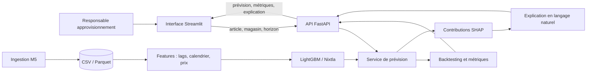
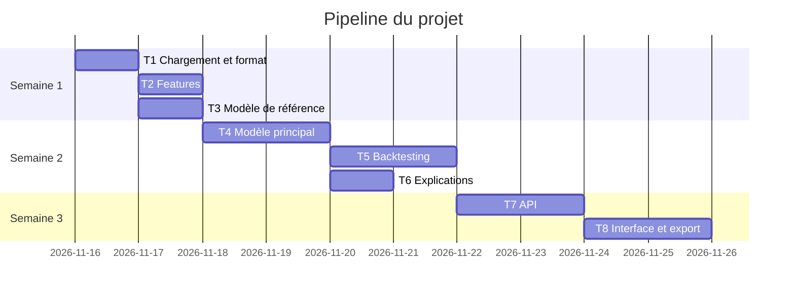

# Dossier de lancement (semaine 1)

Nov 9, 2026 · @Larhlimi

## Mode d'emploi

La semaine 1 est décisive : sur un projet de 4 semaines, un cadrage flou ou des données indisponibles ne se rattrapent pas. Ce dossier permet à l'enseignant de valider, faire reprendre ou refuser le projet sous 48 heures.

Le dossier comporte quatre livrables. **L'équipe se les répartit : chaque membre rédige seul le ou les livrables dont il est responsable, puis un autre membre le relit.** Le nom du rédacteur et du relecteur figure en tête de chaque livrable.

**Notre répartition**

| Livrable | Rédacteur | Relecteur | Fichier dans le dépôt |
| --- | --- | --- | --- |
| 1. Descriptif du projet | Amine El Alouani | Achraf Alla | `docs/semaine1/1-descriptif.md` |
| 2. Dataset | Achraf Alla | Amine El Alouani | `docs/semaine1/2-dataset.md` + `data/m5/datasets/` |
| 3. Maquette globale | Amine El Alouani | Achraf Alla | `docs/semaine1/3-maquette.md` + `docs/semaine1/img/` |
| 4. Pipeline des tâches | Achraf Alla | Amine El Alouani | `docs/semaine1/4-pipeline.md` |

## Livrable 1 : descriptif du projet mis à jour

Rédacteur : Amine El Alouani   Relecteur : Achraf Alla   Fichier : `docs/semaine1/1-descriptif.md`

**1.1 Contexte et problème** : un responsable approvisionnement doit anticiper les ventes de chaque article dans chaque magasin pour éviter les ruptures et le surstock. Sans l'agent, il consulte l'historique et applique des estimations manuelles, difficiles à comparer et à justifier. Les effets du calendrier, des prix et des événements sont donc pris en compte de manière inégale.

**1.2 Objectif** : produire une prévision de demande à 28 jours par article et magasin, accompagnée d'une mesure d'erreur et d'une explication lisible des principales variations.

**1.3 Utilisateurs cibles et scénario d'usage principal** : le responsable approvisionnement sélectionne un magasin, un article et un horizon de 7 ou 28 jours. Il lance la prévision, consulte la courbe de demande attendue et les indicateurs d'erreur issus du backtesting, puis ouvre l'explication pour identifier les facteurs associés à la variation. Il peut enfin télécharger le résultat au format CSV.

**1.4 Fonctionnalités du MVP**

| N° | Fonctionnalité | Ce que l'utilisateur voit ou obtient | Priorité |
| --- | --- | --- | --- |
| F1 | Prévoir la demande | Prévision à 7 ou 28 jours pour un article et un magasin sélectionnés | indispensable |
| F2 | Évaluer la fiabilité | MAE, RMSE et sMAPE sur une fenêtre de backtesting | indispensable |
| F3 | Expliquer la variation | Facteurs principaux affichés en langage naturel à partir des variables du modèle | indispensable |
| F4 | Exporter le résultat | Tableau CSV de la prévision et des indicateurs associés | souhaitable |

**1.5 Services et composants techniques**

| Service ou composant | Rôle | Technologie choisie | Pourquoi ce choix |
| --- | --- | --- | --- |
| Modèle | Prévision de séries temporelles | LightGBM avec variables retardées, ou Nixtla en repli | adapté aux séries nombreuses et aux variables calendaires |
| Recherche ou mémoire | Stockage des données et artefacts | CSV/Parquet | suffisant pour le MVP tabulaire |
| Outils appelés par l'agent | Chargement, prévision, évaluation, explication | Python, pandas, SHAP | chaque étape est reproductible |
| API | Exposer prévision, métriques et explication | FastAPI | interface simple et testable |
| Interface | Sélection et visualisation | Streamlit | prototypage rapide |
| Conteneur et CI | Reproduire l'installation et vérifier le code | Docker, GitHub Actions | limite les écarts entre postes |

**1.6 Hors périmètre** : optimisation automatique des commandes, connexion à un ERP ou à des données temps réel, prévision probabiliste, gestion des droits utilisateurs, entraînement sur plusieurs pays et génération d'explications libres sans variables mesurées.

**1.7 Écart avec la fiche du catalogue** : le projet est recentré sur le dataset M5 et un horizon de 28 jours. La boucle de changement automatique de modèle et la validation complète sur Favorita sont des objectifs secondaires, après stabilisation du MVP.

## Livrable 2 : dataset

Rédacteur : Achraf Alla   Relecteur : Amine El Alouani   Fichiers : `docs/semaine1/2-dataset.md` + `data/m5/datasets/`

**2.1 Description**

| Rubrique | Réponse |
| --- | --- |
| Nom et source | M5 Forecasting Accuracy, [Kaggle](https://www.kaggle.com/competitions/m5-forecasting-accuracy) |
| Producteur ou propriétaire | Walmart, données de vente anonymisées publiées pour la compétition M5 |
| Volume | 8 CSV ; environ 470 Mo localement ; 30 490 séries article-magasin et 1 941 jours d'historique d'entraînement |
| Format et structure | CSV : ventes larges par jour (`d_1` à `d_1941`), calendrier, événements, SNAP, prix et poids WRMSSE |
| Langue et période | Libellés principalement en anglais ; du 29/01/2011 au 30/06/2016 |
| Licence et droits | Conditions de la compétition Kaggle ; usage académique et citation de la source |
| Données personnelles | Aucune donnée personnelle ; identifiants de magasins et d'articles conservés |
| Emplacement complet | `data/m5/datasets/` en local ; les fichiers volumineux ne doivent pas être versionnés dans Git |

**2.2 Qualité constatée** : les ventes sont des comptes entiers avec beaucoup de zéros pour les séries peu vendues. Le calendrier contient des valeurs manquantes pour les jours sans événement, et les prix ne sont pas disponibles pour toutes les combinaisons article-semaine. Les contrôles de doublons sur article-magasin-jour seront automatisés à l'ingestion. Le jeu est déséquilibré entre articles et magasins.

**2.3 Justification**

| Fonctionnalité | Données utilisées | En quoi elles suffisent |
| --- | --- | --- |
| F1 | Ventes, calendrier et prix | Les ventes et variables calendaires entraînent une prévision par série ; les prix servent de proxy de promotion. |
| F2 | Train/test M5 et poids WRMSSE | La séparation temporelle permet un backtesting reproductible et le calcul des métriques. |
| F3 | Calendrier, prix, SNAP et contributions SHAP | Les variables explicatives relient une variation prédite à des facteurs observables. |
| F4 | Résultats de prévision et métriques | Les résultats peuvent être sérialisés en CSV sans donnée supplémentaire. |

**2.4 Alternative de repli** : le jeu public [Favorita Grocery Sales Forecasting](https://www.kaggle.com/competitions/favorita-grocery-sales-forecasting) reprend les ventes par magasin et produit, avec une promotion explicite. À défaut d'accès à Kaggle, un petit jeu synthétique avec saisonnalité hebdomadaire et promotions sera généré. Nous perdrons alors la comparaison WRMSSE officielle M5 et une partie de la structure hiérarchique.

**2.5 Jeu de test** : au moins 20 cas article-magasin tirés des séries M5, répartis entre CA, TX et WI et entre niveaux de demande faible et forte. Pour chaque cas, les 28 dernières observations connues servent de vérité terrain ; les réponses attendues sont calculées par script et relues par les deux membres. Nous suivrons MAE, RMSE, sMAPE et, si possible, WRMSSE, avec comparaison à un modèle naïf saisonnier.

## Livrable 3 : maquette globale

Rédacteur : Amine El Alouani   Relecteur : Achraf Alla   Fichiers : `docs/semaine1/3-maquette.md` + `docs/semaine1/img/`

**3.1 Schéma d'architecture**

**3.2 Légende** : l'interface et l'API servent F1 et F4 ; l'ingestion et le stockage préparent F1 à F3 ; les features et le modèle produisent F1 ; le backtesting sert F2 ; SHAP et l'explication servent F3.

**3.3 Maquette des écrans**

| Écran | Image | Fonctionnalités affichées | Action principale |
| --- | --- | --- | --- |
| Sélection et lancement | `img/ecran-selection.png` | Article, magasin, horizon, bouton de calcul (F1) | Choisir les paramètres puis lancer |
| Résultat de prévision | `img/ecran-prevision.png` | Courbe à 7/28 jours, tableau exportable (F1, F4) | Examiner et télécharger le CSV |
| Qualité et explication | `img/ecran-explication.png` | MAE/RMSE/sMAPE et facteurs principaux (F2, F3) | Consulter la fiabilité et l'explication |

**3.4 Parcours utilisateur** : écran Sélection → choix de l'article, du magasin et de l'horizon → clic sur « Calculer » → écran Résultat de prévision → clic sur « Voir la qualité et l'explication » → écran Qualité et explication → export CSV facultatif.

## Livrable 4 : pipeline des tâches prévues

Consolidateur : Achraf Alla   Relecteur : Amine El Alouani   Fichier : `docs/semaine1/4-pipeline.md`

**4.1 Liste des tâches**

| ID | Tâche | Fonctionnalité | Responsable | Dépend de | Semaine | Terminée quand ? |
| --- | --- | --- | --- | --- | --- | --- |
| T1 | Valider le chargement M5 et le format commun | F1 | Achraf Alla | - | 1 | Le script produit `unique_id`, `ds`, `y` sans erreur |
| T2 | Construire les variables calendrier, prix et lags | F1, F3 | Amine El Alouani | T1 | 1 | Les features sont générées sans fuite temporelle |
| T3 | Implémenter le modèle de référence saisonnier | F1, F2 | Achraf Alla | T1 | 1 | Une prévision à 28 jours est produite pour 20 séries |
| T4 | Entraîner le premier modèle ML/statistique | F1 | Amine El Alouani | T2 | 2 | Le modèle sauvegardé prédit les 28 jours de l'échantillon |
| T5 | Ajouter le backtesting et les métriques | F2 | Achraf Alla | T3, T4 | 2 | MAE, RMSE et sMAPE sont calculés automatiquement |
| T6 | Ajouter l'explication des contributions | F3 | Amine El Alouani | T4 | 2 | Les trois facteurs principaux sont disponibles |
| T7 | Exposer les fonctions par FastAPI | F1, F2, F3 | Achraf Alla | T5, T6 | 3 | Les endpoints répondent avec un JSON documenté |
| T8 | Construire l'interface Streamlit et l'export | F1, F2, F3, F4 | Amine El Alouani | T7 | 3 | Le scénario complet est démontrable jusqu'à l'export |

**4.2 Jalons hebdomadaires**

| Semaine | Jalon démontrable | Tâches qui y mènent |
| --- | --- | --- |
| 1 | Dossier fusionné, chargement M5 et prototype de référence | T1, T2, T3 |
| 2 | Modèle, backtesting et premières explications | T4, T5, T6 |
| 3 | MVP complet, API, interface, Docker et CI au vert | T7, T8 |
| 4 | Résultats mesurés, code gelé et soutenance | Tous les tests et la documentation |

**4.3 Vue chronologique**

**4.4 Chemin critique et charge**

- Chaîne critique : T1, T2, T4, T5, T7, T8. T3 et T6 peuvent avancer en parallèle après T1/T4.
- Charge par membre : Amine El Alouani, 8 jours ; Achraf Alla, 8 jours.

## Remise et décision de l'enseignant

**Checklist de remise**

- [ ] `docs/semaine1/README.md` avec la répartition rédacteurs/relecteurs
- [ ] Les quatre livrables fusionnés après approbation par le relecteur
- [ ] Un échantillon léger dans `data/sample/` ou une procédure de génération documentée
- [ ] Schéma et écrans visibles sur GitHub
- [ ] Issues GitHub créées pour les tâches du pipeline
- [ ] Étiquette `semaine1-remis` posée et enseignant prévenu

**Décision de l'enseignant** : ☐ Validé   ☐ À reprendre   ☐ Refusé

Date et visa : ____________________
