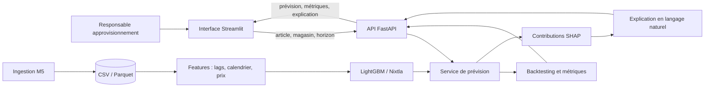

# Fiche de cadrage du projet

**Cours** : Développement et déploiement d'applications intelligentes **Projet d'agent IA en binôme**

> **Consignes générales**

> - Remplissez chaque section de ce document. Les consignes en italique indiquent ce qui est attendu.  
> - Nommez le fichier selon la convention : `NomBinome_ProjetXX.md` (exemple : `Larhlimi-Benali_Projet07.md`).  
> - Le document est à remettre avec le dataset (fichier CSV joint ou lien fonctionnel) et la maquette.  
> - Les réponses courtes ou de type oui/non ne sont pas acceptées dans le questionnaire de la section 8\.

---

## 1\. Identification du binôme

*Indiquez les informations de chaque membre. Le groupe correspond à votre section de cours.*

|  | Membre 1 | Membre 2 |
| :---- | :---- | :---- |
| Nom | El Alouani | Alla |
| Prénom | Amine | Achraf |
| Adresse courriel | Amine.elalouani@emsi-edu.ma | Achraf.alla@emsi-edu.ma |
| Groupe / Section | G2 | G2 |

---

## 2\. Projet choisi

*Reportez le numéro et l'intitulé exact du projet tel qu'il apparaît dans la liste des 40 projets (`projets-agents-ia.md`).*

- **Numéro du projet** :  35
- **Intitulé du projet** : Agent de prévision de la demande
- **Type** : ☐ Informatique (1 à 20\)  ☒ Industriel (21 à 40\)  
- **Catégorie** (ex. : Sécurité, Génie logiciel, Maintenance industrielle) : Prévision des ventes et optimisation de l'approvisionnement

---

## 3\. Descriptif proposé

*Entre 150 et 300 mots. Décrivez le problème à résoudre, les utilisateurs cibles, les fonctionnalités principales de l'agent et le périmètre retenu pour le cours. Soyez précis sur ce qui sera réalisé et sur ce qui ne le sera pas.*

**Problème à résoudre**

Un responsable approvisionnement doit anticiper les ventes de chaque article dans chaque magasin afin d'éviter les ruptures et le surstock. Aujourd'hui, il consulte l'historique des ventes et produit souvent des estimations manuelles dans un tableur. Cette méthode est longue, difficile à reproduire et prend en compte de manière inégale la saisonnalité, les jours fériés, les promotions et les variations de prix. Le projet consiste à créer un agent capable d'analyser ces données et de produire une prévision de demande à 7 ou 28 jours pour un article et un magasin sélectionnés.

**Utilisateurs cibles**

L'utilisateur principal est le responsable approvisionnement ou l'analyste des ventes. Il sélectionne un magasin, un article et un horizon, puis consulte la courbe prévisionnelle, les métriques de fiabilité et une explication des principales variations. L'agent est également destiné à l'équipe projet et à l'enseignant pour vérifier la qualité des prédictions et la traçabilité du pipeline.

**Fonctionnalités principales de l'agent**

1. Prévoir la demande à 7 ou 28 jours par article et par magasin.
2. Afficher l'historique, la prévision et un tableau exportable dans un tableau de bord.
3. Calculer MAE, RMSE et sMAPE par backtesting et signaler une dégradation éventuelle.
4. Expliquer les variations à partir des facteurs mesurés (lags, calendrier, prix et événements) et exporter les résultats en CSV.

**Périmètre retenu pour le cours**

| Inclus dans le projet | Exclu du projet (hors périmètre) |
| :---- | :---- |
| Historique des ventes M5, préparation des variables calendaires et de prix | Connexion temps réel à un ERP ou à une caisse |
| Modèle LightGBM, prévisions à 7/28 jours et backtesting | Optimisation automatique des quantités de commande et des stocks |
| API, tableau de bord et explications fondées sur SHAP | Prévision probabiliste complète, multi-pays et gestion des droits utilisateurs |

---

## 4\. Dataset

*Indiquez le jeu de données que l'agent utilisera (documents, logs, tickets, mesures capteurs, etc.). Joignez le fichier CSV ou fournissez un lien fonctionnel. Si les données sont générées ou simulées, expliquez la méthode de génération.*

| Élément | Réponse |
| :---- | :---- |
| Nom du fichier CSV joint ou lien | [M5 Forecasting Accuracy](https://www.kaggle.com/competitions/m5-forecasting-accuracy) ; fichiers téléchargés dans `data/m5/datasets/` |
| Source (site, organisme, génération propre) | Walmart, données anonymisées publiées sur Kaggle pour la compétition M5 |
| Taille approximative (lignes, colonnes, Mo) | 8 CSV, environ 470 Mo, 30 490 séries article-magasin et 1 941 jours d'historique d'entraînement |
| Licence ou conditions d'utilisation | Conditions de la compétition Kaggle ; usage académique et citation de la source |
| Format des données (CSV, JSON, PDF, logs, images) | CSV : ventes larges par jour (`d_1` à `d_1941`), calendrier, événements, SNAP, prix et poids WRMSSE |

**Description des colonnes ou champs principaux**

| Colonne / Champ | Type | Description | Exemple de valeur |
| :---- | :---- | :---- | :---- |
| `item_id` | Texte | Identifiant du produit | `FOODS_1_001` |
| `store_id` | Texte | Identifiant du magasin | `CA_1` |
| `d` / `date` | Texte / date | Jour d'observation et date calendrier | `d_1914` / `2016-05-22` |
| `sales` (`y`) | Entier positif | Quantité vendue pour le produit et le magasin | `12` |

**Si les données sont générées ou simulées, décrivez la méthode :**

Les données ne sont pas générées : les fichiers M5 sont téléchargés avec `datasetsforecast` puis conservés localement dans `data/m5/datasets/`, car ils sont volumineux et ne doivent pas être versionnés. Le loader transforme le format large (`d_1`, `d_2`, etc.) en format long avec `unique_id`, `ds` et `y`. Les valeurs manquantes du calendrier sont remplacées par une catégorie « aucun événement », les doublons sont contrôlés et les variables de prix, de calendrier et de retard sont ajoutées. Pour les tests rapides, un sous-ensemble d'au moins 20 séries est extrait en conservant des magasins de Californie, du Texas et du Wisconsin. En cas d'accès impossible à Kaggle, un petit jeu synthétique avec saisonnalité hebdomadaire et promotions servira de repli.

**Période, données personnelles et alternative de repli :**

Les données couvrent la période du 29/01/2011 au 30/06/2016. Elles ne contiennent aucune donnée personnelle ; seuls des identifiants anonymisés de magasins et d'articles sont conservés. L'alternative est le dataset public [Favorita Grocery Sales Forecasting](https://www.kaggle.com/c/favorita-grocery-sales-forecasting), mais la comparaison WRMSSE officielle M5 et une partie de la structure hiérarchique seraient alors perdues.

---

## 5\. Proposition de maquette

*Décrivez l'interface ou le flux d'interaction avec l'agent : écrans, entrées de l'utilisateur, sorties de l'agent. Joignez un schéma ou un lien vers une maquette (Figma, image, dessin scanné). Ajoutez également un schéma d'architecture simplifié de l'agent.*

### 5.1 Interface et flux d'interaction

**Type d'interface** : ☒ Application web  ☐ Interface en ligne de commande  ☒ API  ☐ Chatbot (Slack, Teams, etc.)  ☒ Tableau de bord  ☐ Autre :

**Écrans ou étapes principales**

| Écran / Étape | Ce que l'utilisateur fait (entrée) | Ce que l'agent renvoie (sortie) |
| :---- | :---- | :---- |
| Sélection et lancement | Choisit un magasin, un article et un horizon de 7 ou 28 jours, puis lance le calcul | Vérifie les paramètres et déclenche F1 |
| Résultat de prévision | Consulte la courbe à 7/28 jours et le tableau des résultats | Renvoie la prévision et permet de télécharger le CSV (F1, F4) |
| Qualité et explication | Consulte la fiabilité et les facteurs principaux | Affiche MAE/RMSE/sMAPE et l'explication en langage naturel (F2, F3) |

**Lien ou fichier de la maquette** : `docs/semaine1/3-maquette.md` et `docs/semaine1/img/` (`ecran-selection.png`, `ecran-prevision.png`, `ecran-explication.png`)

### 5.2 Schéma d'architecture de l'agent

*Représentez les composants principaux : utilisateur, orchestrateur ou agent, LLM, outils appelés, base de données ou base vectorielle, sources de données. Vous pouvez utiliser un bloc Mermaid, un schéma ASCII ou une image.*

&nbsp;

**Explication du schéma**

L'interface et l'API servent la prévision et l'export ; l'ingestion et le stockage préparent les données ; les features et le modèle produisent la prévision ; le backtesting calcule les métriques ; SHAP et le LLM servent l'explication. L'interface Streamlit transmet les paramètres à l'API FastAPI, qui appelle le service de prévision. Celui-ci charge les données M5, construit les variables de calendrier, de prix et de retard, puis utilise LightGBM ou Nixtla en repli. L'API renvoie la prévision, les indicateurs et l'explication à l'interface.

---

## 6\. Technologies et outils

*Complétez les deux tableaux. Chaque ligne doit comporter une justification courte du choix. Les deux volets (développement et déploiement) sont obligatoires.*

### 6.1 Développement

| Catégorie | Outil ou technologie choisi | Justification du choix |
| :---- | :---- | :---- |
| Langage de programmation | Python 3.11 | Adapté à l'analyse de données, au machine learning et aux API |
| Framework d'agents (LangChain, LlamaIndex, CrewAI, AutoGen, etc.) | LangChain | Permet d'orchestrer les outils de chargement, prévision, évaluation et explication |
| Modèle LLM (fournisseur et modèle) | Anthropic Claude via API | Produit des explications concises à partir de résultats calculés, sans remplacer le modèle de prévision |
| Base vectorielle (si RAG) | Aucune pour le MVP ; Parquet pour les données | Le besoin porte sur des séries temporelles structurées, pas sur une recherche documentaire |
| Bibliothèques principales | pandas, NumPy, LightGBM, scikit-learn, SHAP, StatsForecast/Nixtla | Couvrent la préparation, la prévision principale et de repli, l'évaluation et l'explicabilité |
| Outils de test | pytest et tests de scénarios API | Automatisent les tests unitaires, d'intégration et de non-régression |
| Gestion de version (Git, GitHub) | Git et GitHub | Assurent l'historique, la revue et le travail en binôme |

### 6.2 Déploiement

| Catégorie | Outil ou technologie choisi | Justification du choix |
| :---- | :---- | :---- |
| Conteneurisation (Docker, etc.) | Docker Compose | Reproduit l'environnement de l'API et de l'interface |
| Hébergement (cloud, serveur, local) | Démonstration locale, puis Render ou serveur de l'école | Limite les coûts tout en permettant une URL de démonstration |
| CI/CD | GitHub Actions | Lance les tests et vérifie chaque modification poussée |
| Monitoring et journalisation | Logs Python structurés et métriques FastAPI | Facilite le diagnostic des erreurs et le suivi du temps de réponse |
| Gestion des secrets et clés API | Variables d'environnement `.env` non versionnées | Évite d'exposer la clé LLM dans le dépôt |
| Exposition de l'application (API, interface web) | FastAPI avec interface Streamlit | Sépare le service calculable de l'interface destinée à l'utilisateur |

---

## 7\. Répartition des tâches et calendrier

*Indiquez qui fait quoi et les principales étapes jusqu'à la remise finale.*

| Étape | Responsable (Membre 1 / Membre 2 / Les deux) | Date de début | Date de fin | Livrable |
| :---- | :---- | :---- | :---- | :---- |
| Validation du chargement M5 et du format commun (T1) | Membre 2 | 16/11/2026 | 16/11/2026 | `unique_id`, `ds`, `y` produits sans erreur |
| Construction des variables calendrier, prix et lags (T2) | Membre 1 | 17/11/2026 | 17/11/2026 | Variables générées sans fuite temporelle |
| Modèle de référence saisonnier (T3) | Membre 2 | 17/11/2026 | 17/11/2026 | Prévision à 28 jours pour 20 séries |
| Entraînement du modèle principal (T4) | Membre 1 | 18/11/2026 | 19/11/2026 | Modèle sauvegardé et prévision des 28 jours |
| Backtesting et métriques (T5) | Membre 2 | 20/11/2026 | 21/11/2026 | MAE, RMSE et sMAPE calculés automatiquement |
| Explication des contributions (T6) | Membre 1 | 20/11/2026 | 20/11/2026 | Trois facteurs principaux disponibles |
| Exposition par FastAPI (T7) | Membre 2 | 22/11/2026 | 23/11/2026 | Endpoints avec JSON documenté |
| Interface Streamlit et export (T8) | Membre 1 | 24/11/2026 | 25/11/2026 | Scénario complet démontrable jusqu'à l'export |

---

## 8\. Questionnaire de cadrage

*Répondez à chacune des 15 questions de façon détaillée (plusieurs phrases par réponse). Ces réponses serviront de base à l'évaluation de la compréhension du projet.*

### Compréhension du besoin

**Q1. Quel problème concret votre agent résout-il, et comment ce problème est-il traité aujourd'hui sans agent IA ?**

L'agent résout le problème de l'estimation manuelle de la demande par article et par magasin. Sans agent, le responsable consulte des tableaux historiques et applique des règles ou une moyenne, ce qui ignore parfois les effets du calendrier, des prix et des événements. Notre solution automatise la préparation des données, produit une prévision à 7 ou 28 jours et indique les métriques obtenues sur des périodes historiques.

**Q2. Qui est l'utilisateur final de votre agent, et comment interagit-il avec lui au quotidien ?**

L'utilisateur final est le responsable approvisionnement ou l'analyste des ventes. Au quotidien, il sélectionne un magasin, un article et un horizon dans le tableau de bord, lance la prévision, vérifie la fiabilité puis consulte l'explication des variations. Il peut exporter les résultats en CSV pour les partager ou les comparer avec son processus actuel.

**Q3. Quelle valeur ajoutée apporte l'agent par rapport à une solution classique (script, règles fixes, recherche manuelle) ?**

La valeur ajoutée vient de la combinaison de la prévision automatique, du backtesting et de l'explication. Un script classique peut calculer une moyenne, mais il ne fournit pas nécessairement une mesure de fiabilité par série ni une justification lisible des facteurs utilisés. L'agent orchestre plusieurs outils, conserve le contexte de la demande et signale clairement lorsqu'une donnée est absente ou qu'une erreur dépasse le seuil prévu.

### Raisonnement et comportement de l'agent

**Q4. Quelles sont les entrées de l'agent et quelles sorties produit-il ? Donnez un exemple complet d'interaction.**

Les entrées sont l'identifiant du magasin, l'identifiant de l'article, l'horizon demandé (7 ou 28 jours) et la date de référence. Les sorties sont une série de quantités prévues, les métriques MAE/RMSE/sMAPE et une explication des facteurs importants. Par exemple, l'utilisateur choisit `CA_1`, `FOODS_1_001` et 7 jours ; l'agent charge l'historique, calcule les retards et variables de calendrier, renvoie les sept valeurs prévues, affiche le sMAPE du backtesting et explique qu'une hausse est principalement associée au jour de la semaine et à l'évolution du prix.

**Q5. Quelles décisions l'agent prend-il de façon autonome, et quels outils externes appelle-t-il pour y parvenir (recherche, base de données, exécution de code, API) ?**

L'agent décide du modèle et de l'horizon à utiliser parmi les options validées, sélectionne la série demandée et déclenche le calcul des métriques. Il appelle des outils Python pour charger les fichiers Parquet/CSV, construire les variables, exécuter LightGBM, calculer SHAP et lancer le backtesting. Le LLM ne prend pas de décision métier et ne peut reformuler que les valeurs et facteurs fournis par ces outils.

**Q6. Quel type de mémoire votre agent utilise-t-il (contexte de conversation, mémoire à long terme, base vectorielle) et pourquoi ?**

Le MVP utilise une mémoire de contexte courte pour conserver les paramètres de la requête pendant l'interaction. Les données historiques et les modèles sont stockés dans des fichiers Parquet et les artefacts du modèle sont versionnés par date. Une base vectorielle n'est pas nécessaire, car le contenu principal est tabulaire et temporel ; elle pourrait être ajoutée plus tard pour rechercher de la documentation métier.

### Données

**Q7. Décrivez la qualité de vos données : valeurs manquantes, bruit, déséquilibre, biais potentiels. Quelles étapes de préparation sont prévues ?**

Les ventes sont des comptes entiers, mais les séries de faible volume comportent beaucoup de zéros. Le calendrier contient des valeurs vides lorsqu'il n'y a pas d'événement et les prix peuvent manquer pour certaines combinaisons article-semaine. Le pipeline vérifiera les doublons, normalisera les dates, imputera uniquement les valeurs justifiables, créera un indicateur d'absence et séparera les données dans le temps pour éviter les fuites. Les magasins et articles étant déséquilibrés, les métriques seront calculées à la fois globalement et par sous-groupes.

**Q8. Quelles sont les limites de votre dataset, et comment ces limites influencent-elles les résultats attendus de l'agent ?**

Le dataset M5 est limité à des magasins Walmart anonymisés et à une période historique précise ; il ne représente donc pas tous les secteurs ni les comportements futurs. Les promotions ne sont pas directement disponibles pour chaque observation et seront approchées par les variables de prix et d'événements. Ces limites peuvent réduire la précision lors d'un changement de marché. Nous les documenterons et comparerons le modèle à une baseline naïve saisonnière plutôt que de présenter les prévisions comme certaines.

### Architecture et choix techniques

**Q9. Justifiez le choix de votre framework d'agents et de votre modèle LLM. Quelles alternatives avez-vous écartées et pourquoi ?**

LangChain est retenu pour relier explicitement les outils et contrôler l'ordre de l'orchestration, tandis que Python fournit l'écosystème de séries temporelles nécessaire. LightGBM est adapté à de nombreuses séries et aux variables de retard, de calendrier et de prix ; SHAP permet de les expliquer. Nous avons écarté CrewAI et AutoGen, plus adaptés à plusieurs agents collaboratifs, car un seul orchestrateur suffit ici. Un LLM généraliste est utilisé uniquement pour la formulation, et non pour calculer les quantités.

**Q10. Comment votre architecture gère-t-elle les erreurs (outil indisponible, réponse du LLM incohérente, données manquantes) ?**

Chaque outil valide ses entrées et renvoie une erreur explicite avec un message exploitable. Si un fichier est absent ou si une série n'existe pas, l'API renvoie une réponse HTTP appropriée au lieu d'une prévision vide. Si le LLM est indisponible, l'interface affiche les facteurs SHAP sous forme de tableau et signale que l'explication textuelle n'a pas été générée. Les sorties du modèle sont contrôlées par un schéma structuré et les valeurs aberrantes sont journalisées avant affichage.

### Déploiement

**Q11. Décrivez l'environnement de déploiement cible. Comment un utilisateur accède-t-il à l'agent une fois déployé ?**

L'environnement cible est un conteneur Docker exécutant une API FastAPI et une interface Streamlit. Pour le cours, le déploiement sera d'abord réalisé localement, puis sur Render ou un serveur de l'école si les ressources le permettent. L'utilisateur ouvre l'URL de l'interface, choisit ses paramètres et l'interface appelle l'endpoint de prévision. Les fichiers de données et les modèles sont montés comme ressources en lecture seule.

**Q12. Quels sont les coûts d'exploitation attendus (appels au LLM, hébergement, stockage) et comment comptez-vous les maîtriser ? Que se passe-t-il si le nombre d'utilisateurs augmente ?**

Le principal coût variable est celui des appels au LLM pour les explications ; le calcul de prévision s'effectue localement et le dataset est stocké en fichiers. Nous limiterons les appels en mettant en cache les explications identiques, en envoyant au LLM uniquement les facteurs principaux et en utilisant un modèle léger lorsque c'est possible. Pour une hausse du nombre d'utilisateurs, l'API pourra être séparée de l'interface, les prévisions pourront être mises en cache et les tâches longues placées dans une file. Une limite de requêtes empêchera une consommation excessive.

### Évaluation

**Q13. Quelles métriques utiliserez-vous pour évaluer votre agent (exactitude, pertinence des réponses, temps de réponse, taux de résolution) et quel est votre critère de réussite ?**

Nous suivrons MAE, RMSE, sMAPE et, lorsque les poids sont disponibles, WRMSSE, avec comparaison à la baseline naïve saisonnière. Nous mesurerons également le temps de réponse de l'API et le taux de requêtes terminées sans erreur. Le critère de réussite du MVP est un modèle meilleur que la baseline sur le jeu de test pour au moins 70 % des séries, un sMAPE moyen inférieur à celui de la baseline et un temps de réponse inférieur à 5 secondes hors premier chargement.

**Q14. Quels tests prévoyez-vous (tests unitaires, scénarios de bout en bout, jeu de questions de référence) et comment seront-ils automatisés ?**

Les tests unitaires couvriront la conversion du format M5, la création des retards, la validation des paramètres et le calcul des métriques. Des tests d'intégration appelleront l'API avec un petit dataset fixe et vérifieront la forme des sept ou vingt-huit sorties. Des scénarios de bout en bout testeront une requête valide, un article inconnu et un fichier manquant. Pytest et GitHub Actions automatiseront ces contrôles à chaque modification.

### Risques

**Q15. Identifiez les principaux risques de votre projet (hallucinations, sécurité, fuite de données, éthique, dépendance aux API externes) et décrivez les mesures prévues pour chacun.**

Les hallucinations constituent le principal risque : le prompt imposera au LLM de ne citer que les facteurs et chiffres fournis, et l'interface montrera les données sources. Une clé API ou une donnée sensible pourrait fuiter ; les secrets resteront dans des variables d'environnement et les logs excluront les clés et les identifiants inutiles. Une API externe indisponible entraînera un repli vers une explication déterministe. Les données historiques peuvent introduire un biais de région ou de produit ; nous documenterons cette limite et éviterons toute décision automatique de commande. Enfin, des prévisions anormalement mauvaises seront détectées par les métriques et signalées plutôt que masquées.

---

## 9\. Liste de vérification avant de remettre

- [ ] Le fichier est nommé selon la convention `NomBinome_ProjetXX.md`  
- [ ] Les informations des deux membres et le groupe sont renseignés  
- [ ] Le numéro et l'intitulé du projet correspondent exactement à la liste officielle  
- [ ] Le descriptif fait entre 150 et 300 mots et précise le périmètre  
- [ ] Le dataset est joint (CSV) ou le lien est fonctionnel, avec description des colonnes  
- [ ] La maquette est incluse (lien ou image) ainsi que le schéma d'architecture  
- [ ] Les deux tableaux de technologies (développement et déploiement) sont remplis avec justifications  
- [ ] La répartition des tâches et le calendrier sont complétés  
- [ ] Les 15 questions ont reçu une réponse détaillée  
- [ ] Le document a été relu par les deux membres du binôme